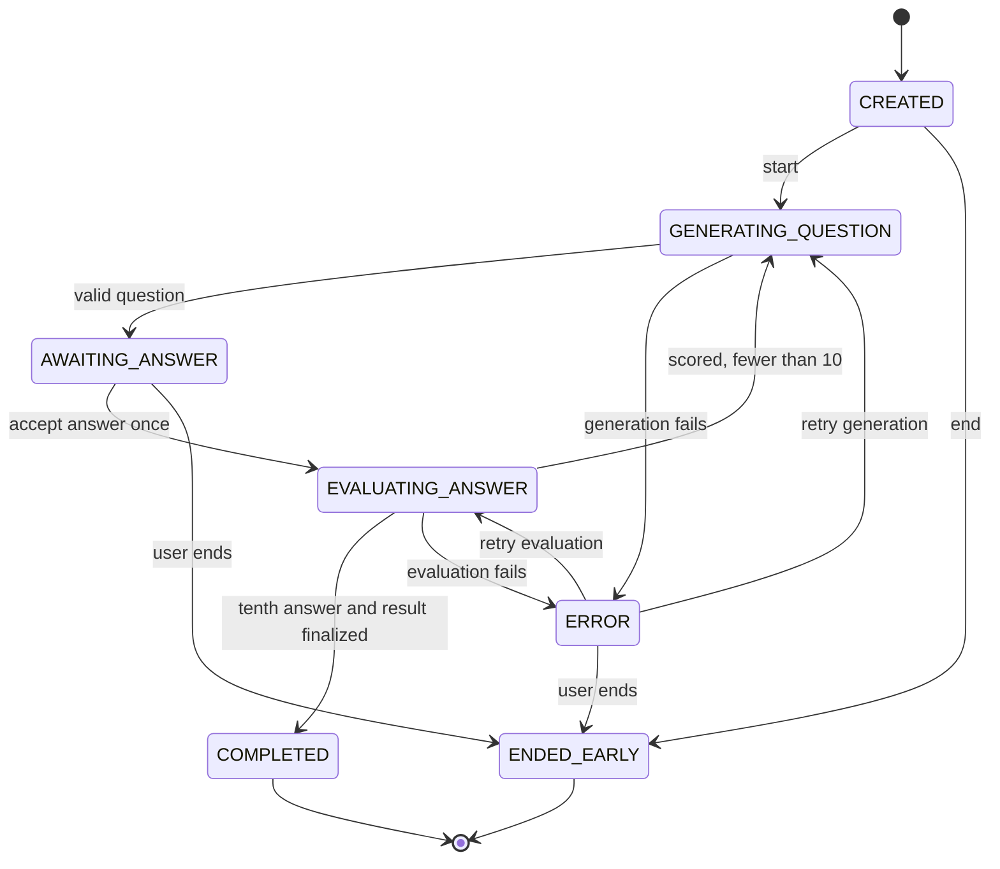

# Interview Session State Flow

## States

| State | Meaning |
|---|---|
| `CREATED` | Session record exists; no question generation has started |
| `GENERATING_QUESTION` | Backend is generating/validating the next question |
| `AWAITING_ANSWER` | One current question may accept one answer |
| `EVALUATING_ANSWER` | Accepted answer is being evaluated and scored |
| `ERROR` | Generation/evaluation failed safely; retry metadata records the resumable operation |
| `COMPLETED` | Ten valid answers are evaluated, the session result is finalized, and Phase 4 role analytics are recomputed |
| `ENDED_EARLY` | User ended before ten valid answers; no competency/readiness update |

## Flow

## Invariants

- `COMPLETED` and `ENDED_EARLY` are terminal.
- Only `AWAITING_ANSWER` accepts an answer.
- The submitted `questionId` must equal the current question.
- The idempotency key prevents double acceptance.
- A valid evaluation is stored before adaptation chooses the next level.
- Question generation and evaluation each get at most one bounded retry.
- `ERROR` records `failedOperation`, `resumeState`, and a safe error code; retry cannot skip a required operation.
- Exactly 10 valid evaluations are required for `COMPLETED`.
- Completion first persists the bounded session result, then recomputes role-specific competency and readiness from all completed evidence.
- Deleting a completed session recomputes the affected role from the remaining completed evidence.
- Early-ended and error sessions remain owner-readable but do not affect any derived analytics.
